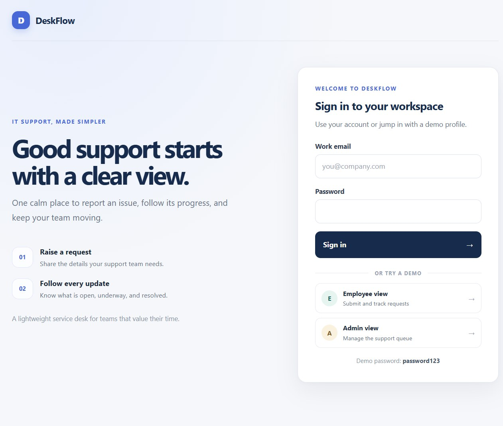
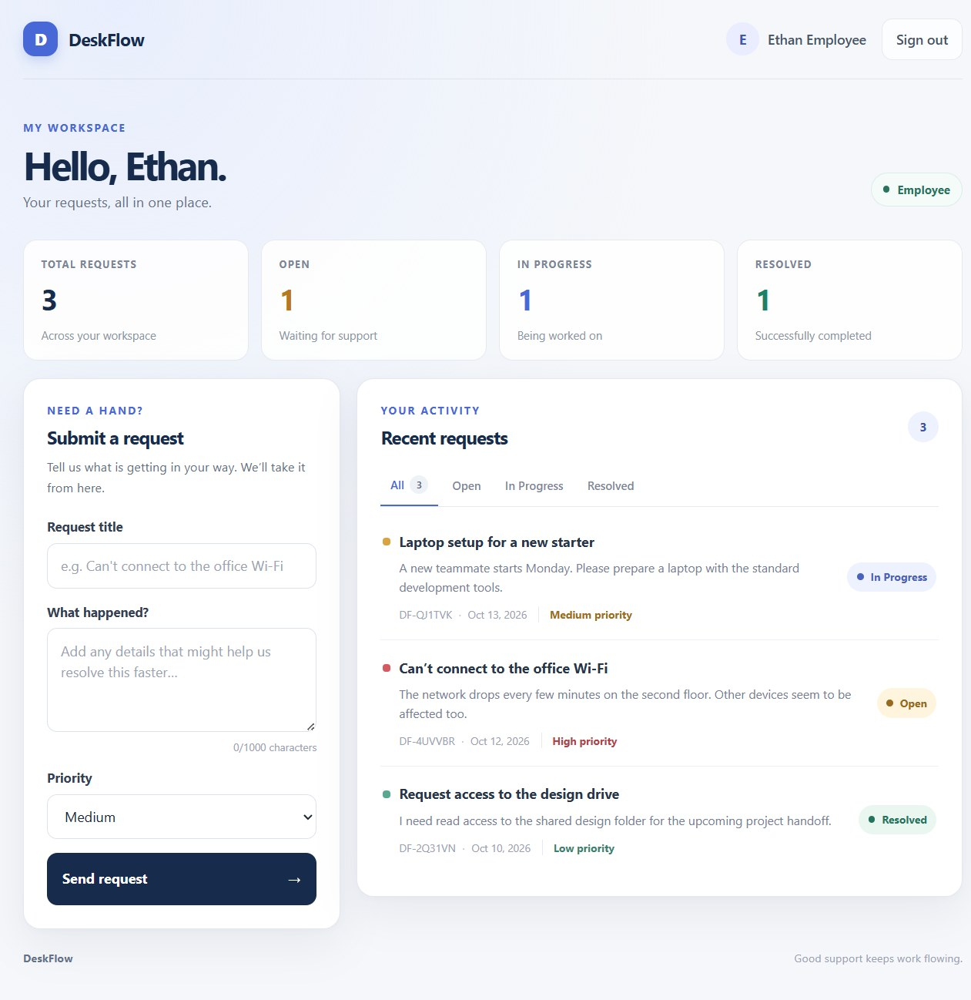
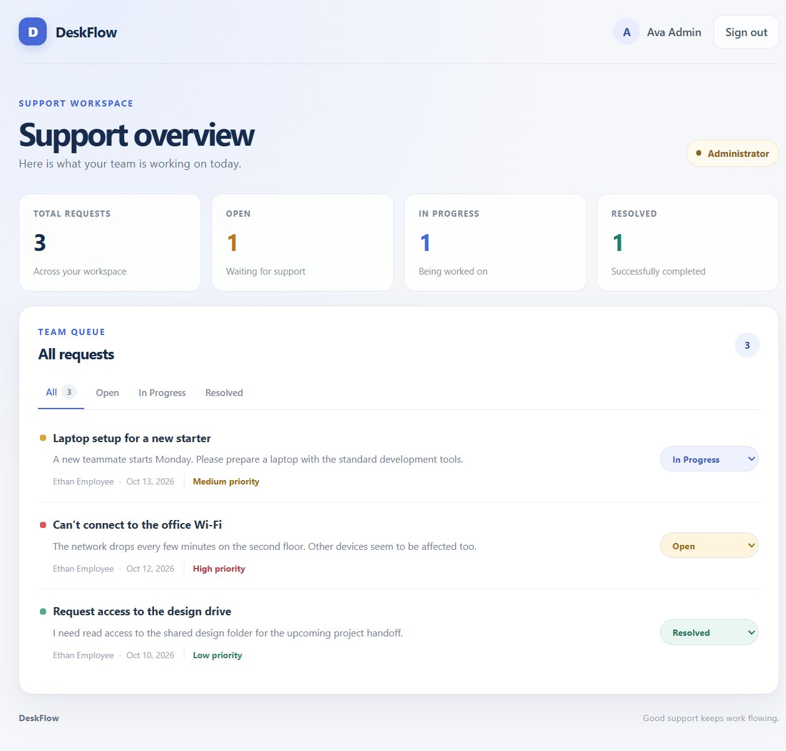
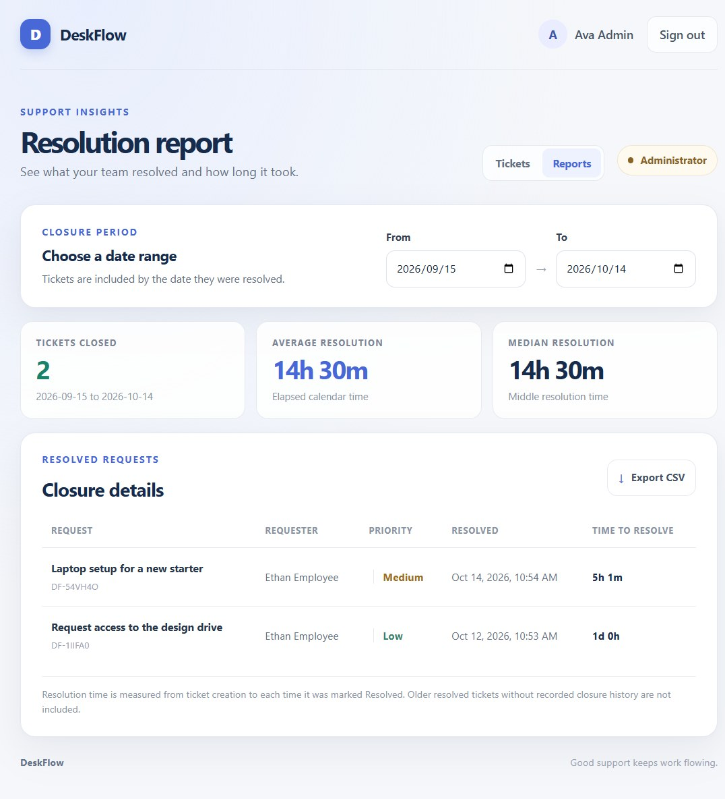

# DeskFlow

DeskFlow is a lightweight IT service desk for small teams. Employees can report issues and follow progress, while administrators can review the team queue and update request statuses.

## Showcase

Run the app locally and open [http://localhost:5173](http://localhost:5173). The development server creates demo accounts and, when the employee account has no requests yet, a small set of sample tickets. Use the demo buttons on the sign-in screen to try each role:

- **Employee:** submit a request and track its status.
- **Admin:** review all requests, move them between Open, In Progress, and Resolved, and view resolution reports.
- **Resolution reports:** choose a date range, see closed tickets with elapsed resolution times and average/median summaries, and export the results to CSV. Fresh demo data includes a sample closure.
- **Demo password:** `password123`

Resolution reports record closure events from the time this feature is installed. Existing resolved tickets without a recorded closure date are not included. Resolution time is elapsed calendar time from ticket creation to resolution.

## Screenshots

<p align="center">
  
  
</p>
<p align="center">
  
  
</p>

## Run locally

Prerequisites: Node.js 20+ and npm.

1. Install dependencies:

   ```sh
   npm install
   npm --prefix frontend install
   ```

2. Create your local environment file:

   ```sh
   cp .env.example .env
   ```

3. Create the local SQLite database and apply the Prisma migration:

   ```sh
   npm run prisma:migrate
   ```

4. Start the backend and frontend:

   ```sh
   npm run dev
   ```

5. Open the app at [http://localhost:5173](http://localhost:5173).

The API is available at [http://localhost:5000](http://localhost:5000), its health check is at `/api/health`, the admin-only resolution report is at `/api/reports/resolutions?from=YYYY-MM-DD&to=YYYY-MM-DD`, and the API reference is at [http://localhost:5000/api-docs](http://localhost:5000/api-docs).

To build the frontend for deployment, run `npm run build`. This project is configured as a demo; before using it with real accounts, replace the demo authentication and seed-account setup with production-grade user and password management. Never use the demo credentials or development secret with real users.
